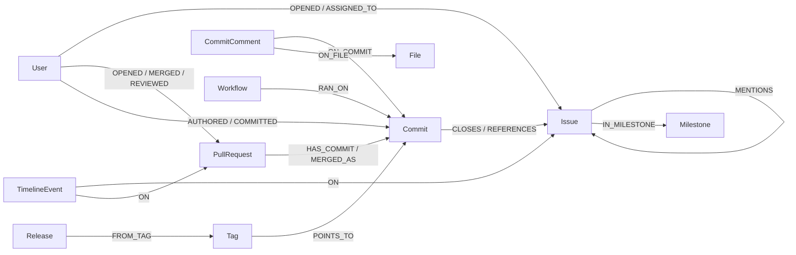

# kg-onboarding

Grafo de conhecimento do repositório [google/guava](https://github.com/google/guava)
construído para apoiar *newcomers* (novos contribuidores) em projetos open source,
por meio de um agente de IA. Projeto de mestrado.

## Objetivo

Quem chega a um projeto open source precisa responder perguntas que dependem de
**relações**, e não só de texto:

- Quem costuma discutir ou revisar mudanças em determinado pacote?
- Qual commit ou PR resolveu esta issue, e quem o escreveu?
- Quem faz o merge de PRs e como o CI se comporta em cada commit?

Este projeto transforma os dados extraídos do GitHub (issues, PRs, commits, eventos,
CI, releases) num grafo no Neo4j. Um agente de IA usará esse grafo como base para
responder a esse tipo de pergunta.

## Como funciona

```
data/raw/guava.sqlite ──► src/etl/carregar_grafo.py ──► Neo4j + GDS ──► agente de IA
   (dados do GitHub)          (ETL idempotente)          (grafo)        (em desenvolvimento)
```

1. **Origem:** um banco SQLite com dados do google/guava extraídos da API do GitHub
   (1.446 issues, 1.405 PRs, 7.503 commits, 27.526 eventos de timeline, 1.531 usuários etc.).
2. **ETL:** scripts Python leem o SQLite, decodificam as colunas JSON e gravam nós e
   relações no Neo4j com `MERGE`. Rodar de novo atualiza os dados sem duplicar.
3. **Grafo:** Neo4j 5.26 com o plugin Graph Data Science, para algoritmos como
   centralidade e detecção de comunidades.

### Modelo do grafo (resumo)



O modelo completo, a origem de cada relação e as decisões de modelagem estão em
[docs/modelo_grafo.md](docs/modelo_grafo.md).

## Requisitos

- [uv](https://docs.astral.sh/uv/) (instala o Python 3.12 e as dependências)
- Docker com Docker Compose (Neo4j e Ollama rodam em containers)
- O arquivo `guava.sqlite` (não versionado; obtido separadamente)

## Instalação

```bash
git clone <url-deste-repositório> kg-onboarding && cd kg-onboarding
uv sync                                     # cria .venv com Python 3.12 e dependências

mkdir -p data/raw && cp /caminho/para/guava.sqlite data/raw/
```

Crie um `.env` na raiz a partir de `.env.example` (`cp .env.example .env`; ele está no `.gitignore`):

```dotenv
NEO4J_URI=bolt://localhost:7687
NEO4J_USER=neo4j
NEO4J_PASSWORD=<uma senha forte>
```

Suba o Neo4j e confira o ambiente:

```bash
docker compose up -d                        # aguarde "Started." em: docker logs neo4j-mestrado
uv run src/etl/teste_conexao.py
```

Saída esperada:

```
[OK] .env carregado
[OK] SQLite: 1446 linhas em issues (esperado 1446)
[OK] Neo4j: conectado em bolt://localhost:7687
Tudo OK.
```

## Uso

### Carregar o grafo

```bash
uv run src/etl/carregar_grafo.py               # todas as etapas (~16 s)
uv run src/etl/carregar_grafo.py issues refs   # apenas algumas etapas
uv run src/etl/carregar_grafo.py --limpar      # apaga o grafo e recarrega
```

Etapas disponíveis: `users`, `milestones`, `issues`, `commits`, `pull_requests`,
`timeline`, `commit_comments`, `workflows`, `refs`, `discussions`.
Ao final, o script mostra a contagem de nós e relações por tipo.

### Explorar o grafo

- **Neo4j Browser:** http://localhost:7474 (usuário `neo4j`, senha do `.env`)
- **Terminal:**
  ```bash
  docker exec -it neo4j-mestrado cypher-shell -u neo4j -p "$(grep ^NEO4J_PASSWORD .env | cut -d= -f2-)"
  ```
- **Python / notebooks:** `uv run jupyter lab` (salve os notebooks em `notebooks/`)

### Exemplos de consulta

Pessoas que mais discutem issues do pacote `cache` (candidatas a mentoras):

```cypher
MATCH (i:Issue)<-[:ON]-(:TimelineEvent {type: 'commented'})<-[:PERFORMED]-(u:User)
WHERE 'package=cache' IN i.labels AND u.login <> 'gissuebot'
RETURN u.login, count(DISTINCT i) AS issues
ORDER BY issues DESC LIMIT 5;
```

```
ben-manes  9
lowasser   8
kevinb9n   6
...
```

Commits que fecharam issues, com seus autores:

```cypher
MATCH (a:User)-[:AUTHORED]->(c:Commit)-[:CLOSES]->(i:Issue)
RETURN i.number, i.title, a.login LIMIT 10;
```

Quem faz merge de PRs:

```cypher
MATCH (u:User)-[:MERGED]->(:PullRequest)
RETURN u.login, count(*) AS merges ORDER BY merges DESC LIMIT 5;
```

Linha do tempo de uma issue:

```cypher
MATCH (i:Issue {number: 3})<-[:ON]-(e:TimelineEvent)
OPTIONAL MATCH (u:User)-[:PERFORMED]->(e)
RETURN e.position, e.type, u.login, left(e.body, 80)
ORDER BY e.position;
```

### Ferramentas do agente

As consultas que o agente usará estão em `src/kg_onboarding/ferramentas.py`, cada uma
ligada a uma dúvida típica de newcomer ([docs/perguntas_newcomer.md](docs/perguntas_newcomer.md)).
Todas rodam em modo somente leitura e podem ser chamadas pelo terminal:

```bash
uv run kg-onboarding                                        # lista as ferramentas
uv run kg-onboarding especialistas_do_pacote pacote=cache limite=3
```

```json
[
  {"login": "ben-manes", "comentarios": 12, "prs": 1, "commits": 2, "pontuacao": 20, ...},
  {"login": "lowasser",  "comentarios": 8,  "revisoes": 1, "pontuacao": 11, ...},
  {"login": "kluever",   "comentarios": 5,  "revisoes": 1, "pontuacao": 8, ...}
]
```

Testes de integração (exigem o Neo4j com o grafo carregado), que também verificam o
gabarito de avaliação em `avaliacao/perguntas.jsonl`:

```bash
uv run pytest
```

### Teste com newcomers (MVP)

Para testar sem que o participante precise de Docker, banco ou chave de API, o pacote
leva guias pré-gerados de algumas issues (`src/kg_onboarding/dados/guias.json`). Sem
Neo4j acessível, o comando `kgo` entra em modo offline e usa esses guias.

```bash
uv run kg-onboarding exportar 669 2098 ...   # gera/atualiza guias (precisa do grafo e do LLM)
uv build --wheel                             # cria dist/kg_onboarding-<versão>-py3-none-any.whl
```

Envie o `.whl` e as instruções de [docs/teste_mvp.md](docs/teste_mvp.md). O participante
instala com `uv tool install <arquivo>.whl` e usa `kgo <issue>`. No clone, `uv run kgo
<issue>` roda ao vivo; `--offline` força os guias pré-gerados.

### Guia de uma issue

Implementa o atendimento ao newcomer descrito em [docs/arquitetura.md](docs/arquitetura.md):
o LLM interpreta a issue, o grafo fornece o contexto relacionado (itens semelhantes,
pessoas, código citado, processo) e o LLM redige um guia em português.

O LLM pode ser o Claude, pela API da Anthropic, ou um modelo local no
[Ollama](https://ollama.com). Todas as variáveis estão em [.env.example](.env.example).

**Claude (padrão quando há chave).** Coloque a chave no `.env`; o modelo padrão é o
`claude-haiku-5-5`, o mais barato (US$ 0,10 / 0,50 por milhão de tokens de entrada/saída;
um guia custa frações de centavo e o custo aparece no rodapé):

```dotenv
ANTHROPIC_API_KEY=sk-ant-...
# LLM_MODELO=claude-sonnet-5-5   # opcional: modelo maior, para comparação
```

Os modelos atuais do Claude não aceitam temperatura nem semente: a reprodutibilidade
vem do esquema JSON na interpretação e do registro de cada resposta.

**Ollama (local, sem custo).** Sem `ANTHROPIC_API_KEY` (ou com `LLM_PROVEDOR=ollama`).
Na primeira vez, baixe o modelo (~2 GB):

```bash
docker compose --profile ollama up -d
docker exec ollama-mestrado ollama pull qwen2.5:3b
```

```bash
uv run kg-onboarding guia 2098              # guia completo (segundos no Claude; ~1 min no Ollama/CPU)
uv run kg-onboarding guia 2098 --sem-llm    # só o contexto do grafo (instantâneo)
uv run kg-onboarding guia 2098 --replay     # só com o que existia quando a issue foi criada
uv run kg-onboarding guia 2098 --json       # saída estruturada completa
```

### Avaliação por replay histórico

```bash
uv run avaliacao/replay.py                  # ~20 s; resultados em data/avaliacao/
uv run avaliacao/replay.py --limite 60 --llm  # termos de busca vindos do LLM (~10 min)
```

Compara o contexto montado "no passado" com o que aconteceu depois (itens
relacionados e pessoas que participaram). Resultados em
[docs/arquitetura.md](docs/arquitetura.md#avaliação-por-replay-histórico).

### Parar o Neo4j

```bash
docker compose down        # os dados ficam em neo4j/data
```

## Estrutura

```
├── data/                  # não versionado
│   ├── raw/guava.sqlite   # banco de origem
│   └── repos/             # clones de repositórios (mineração com PyDriller)
├── docs/modelo_grafo.md   # modelo do grafo e decisões
├── neo4j/                 # volume do Neo4j (não versionado)
├── notebooks/             # análises exploratórias
├── src/
│   ├── etl/
│   │   ├── comum.py           # conexões e utilitários
│   │   ├── carregar_grafo.py  # SQLite -> Neo4j
│   │   └── teste_conexao.py   # verificação do ambiente
│   └── kg_onboarding/
│       ├── grafo.py           # acesso somente leitura ao Neo4j
│       ├── ferramentas.py     # ferramentas de consulta (+ CLI kg-onboarding)
│       ├── guia.py            # guia de uma issue (interpretação → contexto → síntese)
│       └── llm.py             # acesso ao LLM local (Ollama)
├── avaliacao/
│   ├── perguntas.jsonl    # perguntas de newcomer + ferramenta esperada
│   └── replay.py          # avaliação por replay histórico
├── tests/                 # testes de integração
├── docker-compose.yml     # Neo4j 5.26 Community + GDS e Ollama (LLM local)
├── ollama/                # modelos do Ollama (não versionado)
└── pyproject.toml
```

## Convenções

- Scripts de ETL **idempotentes**: sempre `MERGE`, nunca `CREATE` sem chave.
- Caminhos relativos à raiz do projeto.
- Credenciais apenas no `.env`; `data/`, `neo4j/` e `.env` ficam fora do Git.
- Dependências gerenciadas com `uv add <pacote>`.

## Limitações conhecidas

- **Extração incompleta de issues e PRs:** a coleta foi abortada (ver `__checkpoints`
  no SQLite). O banco tem só os itens atualizados há mais tempo: todas as issues estão
  fechadas (2014–2017) e os PRs vão até 2022. Detalhes em
  [docs/perguntas_newcomer.md](docs/perguntas_newcomer.md#limitação-atual-dos-dados).

- Não há ligação direta entre releases e PRs nos dados. Ela depende do histórico git
  (`git tag --contains`), ainda não minerado.
- Cerca de 3.750 commits existem apenas como referência (só o `sha`). A propriedade
  `in_dataset` indica quais estão completos.
- Arquivos (`File`) vêm só de comentários em commits. A relação commit → arquivo
  virá da mineração com PyDriller.
- Contas automatizadas (`gissuebot`, `copybara-service[bot]`) distorcem rankings de
  pessoas e devem ser filtradas.

## Próximos passos

- [ ] Minerar o histórico git com PyDriller (`Commit -[:MODIFIES]-> File`, releases → PRs)
- [ ] Avaliar nós `Label`/`Package` a partir das labels das issues
- [ ] Aplicar algoritmos do GDS (centralidade de contribuidores, comunidades de arquivos)
- [x] Ferramentas de consulta para o agente e gabarito inicial de avaliação
- [ ] Completar a extração de issues e PRs
- [x] Recuperação e consolidação do contexto de uma issue, com avaliação por replay
- [x] Interpretação e síntese com LLM local (Ollama)
- [ ] Comparar a síntese com modelos maiores e avaliar a qualidade do guia

## Autor

Nathan Gabriel Barreto Santos — mestrado, UFMS.
