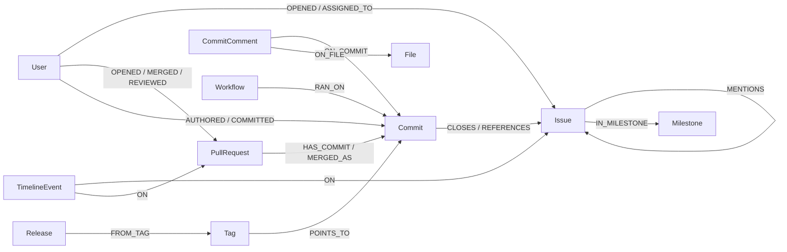

# kg-onboarding

Grafo de conhecimento do repositório [google/guava](https://github.com/google/guava)
construído para apoiar *newcomers* (novos contribuidores) em projetos open source,
por meio de um agente de IA. Projeto de mestrado.

## Objetivo

Quem chega a um projeto open source precisa responder perguntas que dependem de
**relações**, e não só de texto:

- Quem costuma discutir ou revisar mudanças em determinado pacote?
- Qual commit ou PR resolveu esta issue, e quem o escreveu?
- Quem faz o merge de PRs e como o CI se comporta em cada commit?

Este projeto transforma os dados extraídos do GitHub (issues, PRs, commits, eventos,
CI, releases) num grafo no Neo4j. Um agente de IA usará esse grafo como base para
responder a esse tipo de pergunta.

## Como funciona

```
data/raw/guava.sqlite ──► src/etl/carregar_grafo.py ──► Neo4j + GDS ──► agente de IA
   (dados do GitHub)          (ETL idempotente)          (grafo)        (em desenvolvimento)
```

1. **Origem:** um banco SQLite com dados do google/guava extraídos da API do GitHub
   (1.446 issues, 1.405 PRs, 7.503 commits, 27.526 eventos de timeline, 1.531 usuários etc.).
2. **ETL:** scripts Python leem o SQLite, decodificam as colunas JSON e gravam nós e
   relações no Neo4j com `MERGE`. Rodar de novo atualiza os dados sem duplicar.
3. **Grafo:** Neo4j 5.26 com o plugin Graph Data Science, para algoritmos como
   centralidade e detecção de comunidades.

### Modelo do grafo (resumo)



O modelo completo, a origem de cada relação e as decisões de modelagem estão em
[docs/modelo_grafo.md](docs/modelo_grafo.md).

## Requisitos

- [uv](https://docs.astral.sh/uv/) (instala o Python 3.12 e as dependências)
- Docker com Docker Compose
- O arquivo `guava.sqlite` (não versionado; obtido separadamente)

## Instalação

```bash
git clone <url-deste-repositório> kg-onboarding && cd kg-onboarding
uv sync                                     # cria .venv com Python 3.12 e dependências

mkdir -p data/raw && cp /caminho/para/guava.sqlite data/raw/
```

Crie um `.env` na raiz (ele está no `.gitignore`):

```dotenv
NEO4J_URI=bolt://localhost:7687
NEO4J_USER=neo4j
NEO4J_PASSWORD=<uma senha forte>
```

Suba o Neo4j e confira o ambiente:

```bash
docker compose up -d                        # aguarde "Started." em: docker logs neo4j-mestrado
uv run src/etl/teste_conexao.py
```

Saída esperada:

```
[OK] .env carregado
[OK] SQLite: 1446 linhas em issues (esperado 1446)
[OK] Neo4j: conectado em bolt://localhost:7687
Tudo OK.
```

## Uso

### Carregar o grafo

```bash
uv run src/etl/carregar_grafo.py               # todas as etapas (~16 s)
uv run src/etl/carregar_grafo.py issues refs   # apenas algumas etapas
uv run src/etl/carregar_grafo.py --limpar      # apaga o grafo e recarrega
```

Etapas disponíveis: `users`, `milestones`, `issues`, `commits`, `pull_requests`,
`timeline`, `commit_comments`, `workflows`, `refs`, `discussions`.
Ao final, o script mostra a contagem de nós e relações por tipo.

### Explorar o grafo

- **Neo4j Browser:** http://localhost:7474 (usuário `neo4j`, senha do `.env`)
- **Terminal:**
  ```bash
  docker exec -it neo4j-mestrado cypher-shell -u neo4j -p "$(grep ^NEO4J_PASSWORD .env | cut -d= -f2-)"
  ```
- **Python / notebooks:** `uv run jupyter lab` (salve os notebooks em `notebooks/`)

### Exemplos de consulta

Pessoas que mais discutem issues do pacote `cache` (candidatas a mentoras):

```cypher
MATCH (i:Issue)<-[:ON]-(:TimelineEvent {type: 'commented'})<-[:PERFORMED]-(u:User)
WHERE 'package=cache' IN i.labels AND u.login <> 'gissuebot'
RETURN u.login, count(DISTINCT i) AS issues
ORDER BY issues DESC LIMIT 5;
```

```
ben-manes  9
lowasser   8
kevinb9n   6
...
```

Commits que fecharam issues, com seus autores:

```cypher
MATCH (a:User)-[:AUTHORED]->(c:Commit)-[:CLOSES]->(i:Issue)
RETURN i.number, i.title, a.login LIMIT 10;
```

Quem faz merge de PRs:

```cypher
MATCH (u:User)-[:MERGED]->(:PullRequest)
RETURN u.login, count(*) AS merges ORDER BY merges DESC LIMIT 5;
```

Linha do tempo de uma issue:

```cypher
MATCH (i:Issue {number: 3})<-[:ON]-(e:TimelineEvent)
OPTIONAL MATCH (u:User)-[:PERFORMED]->(e)
RETURN e.position, e.type, u.login, left(e.body, 80)
ORDER BY e.position;
```

### Parar o Neo4j

```bash
docker compose down        # os dados ficam em neo4j/data
```

## Estrutura

```
├── data/                  # não versionado
│   ├── raw/guava.sqlite   # banco de origem
│   └── repos/             # clones de repositórios (mineração com PyDriller)
├── docs/modelo_grafo.md   # modelo do grafo e decisões
├── neo4j/                 # volume do Neo4j (não versionado)
├── notebooks/             # análises exploratórias
├── src/
│   ├── etl/
│   │   ├── comum.py           # conexões e utilitários
│   │   ├── carregar_grafo.py  # SQLite -> Neo4j
│   │   └── teste_conexao.py   # verificação do ambiente
│   └── kg_onboarding/     # pacote Python do projeto
├── docker-compose.yml     # Neo4j 5.26 Community + GDS
└── pyproject.toml
```

## Convenções

- Scripts de ETL **idempotentes**: sempre `MERGE`, nunca `CREATE` sem chave.
- Caminhos relativos à raiz do projeto.
- Credenciais apenas no `.env`; `data/`, `neo4j/` e `.env` ficam fora do Git.
- Dependências gerenciadas com `uv add <pacote>`.

## Limitações conhecidas

- Não há ligação direta entre releases e PRs nos dados. Ela depende do histórico git
  (`git tag --contains`), ainda não minerado.
- Cerca de 3.750 commits existem apenas como referência (só o `sha`). A propriedade
  `in_dataset` indica quais estão completos.
- Arquivos (`File`) vêm só de comentários em commits. A relação commit → arquivo
  virá da mineração com PyDriller.
- Contas automatizadas (`gissuebot`, `copybara-service[bot]`) distorcem rankings de
  pessoas e devem ser filtradas.

## Próximos passos

- [ ] Minerar o histórico git com PyDriller (`Commit -[:MODIFIES]-> File`, releases → PRs)
- [ ] Avaliar nós `Label`/`Package` a partir das labels das issues
- [ ] Aplicar algoritmos do GDS (centralidade de contribuidores, comunidades de arquivos)
- [ ] Construir o agente de IA que consulta o grafo

## Autor

Nathan Gabriel Barreto Santos — mestrado, UFMS.
