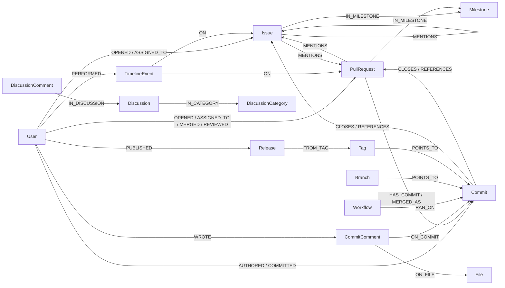

# Modelo do grafo de conhecimento (v0)

Ponto de partida derivado do diagrama conceitual de tabelas. Implementado em
[src/etl/carregar_grafo.py](../src/etl/carregar_grafo.py).



## Nós

| Label | Chave | Origem | Observação |
|---|---|---|---|
| User | `id` | users | `:Contributor` (+`contributions`) e `:Watcher` são labels extras |
| Issue | `id` | issues | `labels` é lista de strings (ex.: `package=cache`) |
| PullRequest | `id` | pull_requests | inclui `merged`, `additions`, `head_ref`, `base_ref` |
| Commit | `sha` | commits | `in_dataset = true` para os 7.503 da tabela; os demais são *stubs* (só `sha`) criados por tags, branches, workflows e PRs, com `in_dataset = false` |
| TimelineEvent | `key` = `source:source_id:position` | timeline_items | `type`, `created_at`, `body` (comentários), `commit_id`, `label_name`, `review_state` |
| Milestone | `id` | milestones | |
| CommitComment | `id` | commit_comments | |
| File | `path` | commit_comments.path | depois será enriquecido via PyDriller |
| Workflow | `id` | workflows (+ workflow_runs) | 2 workflows removidos do repo vêm só das execuções (`state = 'removed'`) |
| Branch / Tag | `name` | branches / tags | |
| Release | `id` | releases | |
| Discussion, DiscussionComment, DiscussionCategory | `node_id` | discussions* | tabelas vazias neste dump; código não testado com dados |

## Do diagrama para o grafo

| Aresta no diagrama | No grafo | De onde vem |
|---|---|---|
| users → issues | `(User)-[:OPENED\|ASSIGNED_TO]->(Issue)` | `user_id`, `assignees` |
| users → pull_requests | `OPENED`, `ASSIGNED_TO`, `MERGED`, `REVIEWED` | `user_id`, `assignees`, `merged_by_id`, eventos `reviewed` |
| users → commits | `AUTHORED`, `COMMITTED` | `author_id`, `committer_id` |
| contributors → users | label `:Contributor` | contributors não é entidade, é atributo do usuário |
| watchers → users | label `:Watcher` | (vazia) |
| issues → milestone | `IN_MILESTONE` | `milestone.id` (JSON) |
| issues → issues (laço) | `MENTIONS` | eventos `cross-referenced`; origem casada por `id` (issue) ou número + título (PR); referências de outros repositórios são descartadas |
| timeline_itens → issues | `(TimelineEvent)-[:ON]->(Issue\|PullRequest)` | um nó por item, mais arestas derivadas (`HAS_COMMIT`, `CLOSES`, `REFERENCES`, `REVIEWED`, `MENTIONS`) |
| commits → issues | `CLOSES`, `REFERENCES` | eventos `closed`/`referenced` com `commit_id` do próprio google/guava (commits de forks ignorados) |
| commits — pull_requests | `HAS_COMMIT`, `MERGED_AS` | eventos `committed` (`sha`); `merge_commit_sha` só quando `merged = 1` |
| commits — commit_comments | `(CommitComment)-[:ON_COMMIT]->(Commit)` | `commit_id` |
| file_path → commit_comments | `(CommitComment)-[:ON_FILE]->(File)` | `path` (146 de 318 comentários) |
| workflows → commits | `(Workflow)-[:RAN_ON]->(Commit)` | 5.714 execuções agregadas por (workflow, commit): `runs`, `success`, `failure`, `last_conclusion`, `last_run_at` |
| branches → commits | `(Branch)-[:POINTS_TO]->(Commit)` | `commit_sha` |
| releases → pull_requests | **`(Release)-[:FROM_TAG]->(Tag)`** | ver pendências |
| tags → pull_requests | **`(Tag)-[:POINTS_TO]->(Commit)`** | ver pendências |
| discussion_* → discussions | `IN_CATEGORY`, `IN_DISCUSSION` | colunas de id |
| discussions → issues | **não implementada** | nenhuma coluna liga discussão a issue |

## Pendências e decisões em aberto

1. **Releases/tags → PRs.** O dado não liga release a PR: a tag aponta para um commit
   (só 7 de 123 estão na tabela `commits`, e só 1 é commit de merge de PR). Para saber
   "em qual versão saiu o PR X" é preciso o histórico git: clonar o repo em
   `data/repos/` e calcular `git tag --contains <merge_commit_sha>`.
2. **Commits incompletos.** A tabela tem 7.503 commits; outros ~3.750 aparecem só como
   referência (stubs). PyDriller pode completar autor, data, mensagem e arquivos.
3. **Arquivos.** `File` hoje só vem de comentários em commit. Com PyDriller entra
   `(Commit)-[:MODIFIES {added, deleted}]->(File)`, essencial para "quem conhece este código".
4. **Labels** estão como propriedade do tipo lista. Se o fluxo precisar navegar por categoria
   (`package=*`, `type=*`, `status=*`), vale criar nós `Label` ou `Package`.
5. **Ruído:** `gissuebot` (id 8091570) é o bot da migração do Google Code e é autor
   de muitas issues antigas e comentários; `copybara-service[bot]` faz muitos merges.
   Filtrar `type = 'Bot'` ou esses ids em análises de pessoas.
6. **Não carregados:** `reactions`, `deployments`/`deployment_statuses` (os sha não
   batem com commits), `repository_events`, `repositories`.

## Consultas de exemplo

```cypher
// Quem mais comenta em issues de um pacote (candidatos a mentor)
MATCH (i:Issue)<-[:ON]-(:TimelineEvent {type:'commented'})<-[:PERFORMED]-(u:User)
WHERE 'package=cache' IN i.labels AND u.login <> 'gissuebot'
RETURN u.login, count(DISTINCT i) AS issues ORDER BY issues DESC LIMIT 5;

// Commits que fecharam issues e seus autores
MATCH (a:User)-[:AUTHORED]->(c:Commit)-[:CLOSES]->(i:Issue)
RETURN i.number, i.title, a.login LIMIT 10;

// Quem faz merge de PRs
MATCH (u:User)-[:MERGED]->(p:PullRequest)
RETURN u.login, count(*) AS merges ORDER BY merges DESC LIMIT 5;

// Linha do tempo de uma issue
MATCH (i:Issue {number: 3})<-[:ON]-(e:TimelineEvent)
OPTIONAL MATCH (u:User)-[:PERFORMED]->(e)
RETURN e.position, e.type, u.login, left(e.body, 80) ORDER BY e.position;
```
